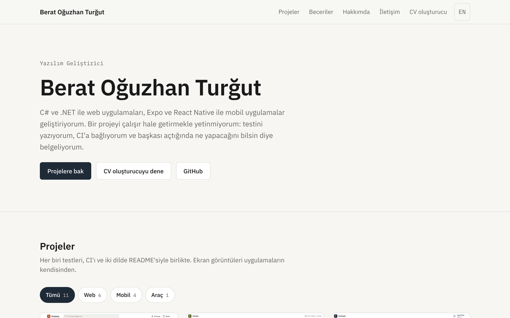
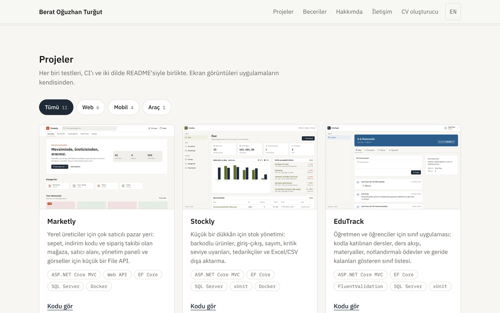
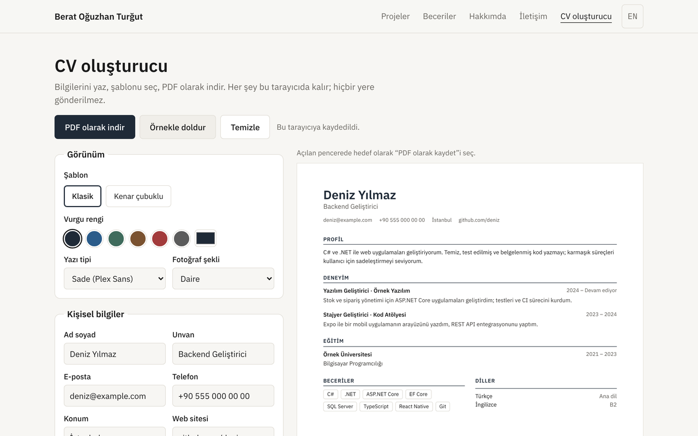
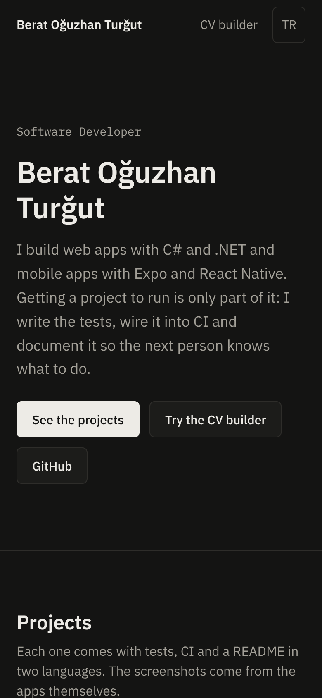
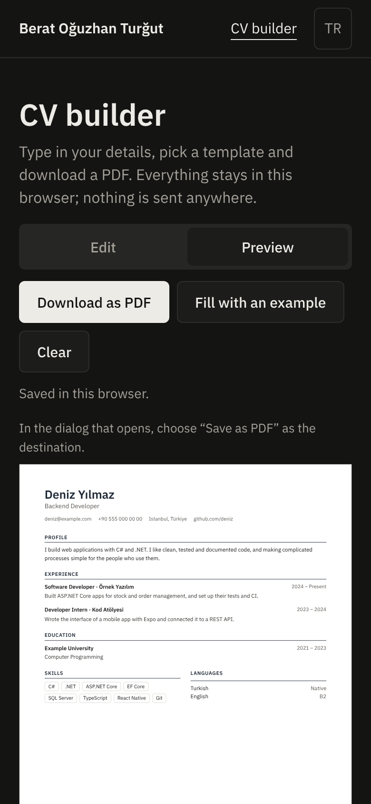
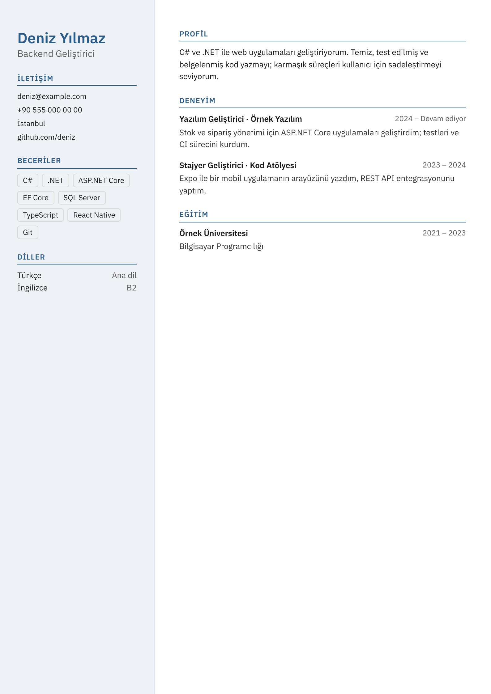

# Portfolio

[English](README.md) · **Türkçe**

Kişisel sitem: yaptığım projeler, kullandığım araçlar, kısa bir tanıtım ve iletişim bilgileri; Türkçe ve İngilizce. İçinde tamamen tarayıcıda çalışan bir CV oluşturucu da var.

[](https://github.com/Beratoguzhan620/portfolio/actions/workflows/ci.yml)


**Canlı site:** [beratoguzhan620.github.io/portfolio](https://beratoguzhan620.github.io/portfolio/)



## Deneme

```bash
pnpm install
pnpm dev        # http://localhost:4321/portfolio/
```

## Özellikler

- **Ana sayfa:**
  - Bir tanıtım, ardından projeler, beceriler, hakkımda ve iletişim bölümleri.
  - Her proje kartında ekran görüntüsü, teknolojiler, kodun linki ve bir canlı demo ya da kayıtlı tanıtım var.
  - Proje listesi web, mobil ya da araç olarak süzülebilir; JavaScript kapalıysa bütün projeler görünür kalır.
- **Türkçe ve İngilizce:** Türkçe `/`, İngilizce `/en/` adresinde. Dil düğmesi aynı sayfada tutar; her sayfa diğer dildeki karşılığını `hreflang` ile bildirir.
- **CV oluşturucu** (`/cv-builder/`):
  - **Canlı önizleme:** yazdıkça A4 sayfa güncellenir.
  - **Şablonlar:** klasik ve kenar çubuklu iki şablon; altı hazır vurgu rengi ya da kendi rengin, iki yazı tipi ve isteğe bağlı fotoğraf.
  - **Kayıtlar:** deneyim, eğitim ve dil ekleyip kaldırma; beceriler virgülle ayrılarak yazılır.
  - **Kaydetme:** bilgiler tarayıcıya otomatik kaydedilir, JSON olarak indirilip geri yüklenebilir. Hiçbir yere gönderilmez.
  - **PDF:** "PDF olarak indir" tarayıcının yazdırma penceresini bir yazdırma stil dosyasıyla kullanır; çıkan PDF'te metin seçilebilir ve sayfa A4 boyutundadır.
  - **Güvenlik:** temizleme ve örnekle değiştirme önce onay ister; yazılanlar asla HTML'e dönüşmez.
  - **Küçük ekranlar:** düzenleme ve önizleme iki ayrı sekmeye ayrılır.
- **Tasarım:** IBM Plex yazı tipi, sistemi takip eden açık ve koyu tema, ortak tasarım sistemi ve mürekkep vurgu rengi.
- **Hızlı ve erişilebilir:** statik sayfalar, siteyle birlikte sunulan yazı tipleri, yeniden boyutlandırılmış WebP ekran görüntüleri. Lighthouse her sayfayı CI'da ölçer; performans ya da erişilebilirlik 95'in altına düşerse CI hata verir.

## Ekran görüntüleri

| Projeler | CV oluşturucu |
|---|---|
|  |  |

| Telefon, koyu | Telefonda CV oluşturucu | Kenar çubuklu şablon |
|---|---|---|
|  |  |  |

## Yayınlama

`Deploy to GitHub Pages` iş akışı, `main`'e yapılan her push'ta siteyi derleyip yayınlar. Açmak için:

1. Repoyu public yap (private repoda Pages ücretli plan ister).
2. **Settings → Pages → Build and deployment → Source** bölümünde **GitHub Actions**'ı seç.
3. `main`'e push et ya da iş akışını **Actions** sekmesinden elle çalıştır. Site `https://beratoguzhan620.github.io/portfolio/` adresinde açılır.

Özel alan adı ya da Netlify için `SITE_BASE=/` (ve `SITE_URL=https://alan-adin`) ile derle; linkler kökten başlar.

## Proje ekleme

1. Ekran görüntüsünü `src/assets/projects/<slug>.png` olarak koy.
2. `src/data/projects.ts` dosyasına iki dilde özet, teknolojiler ve linklerle bir kayıt ekle.

Testler her projenin ekran görüntüsü, iki özeti ve repo linki olduğunu kontrol eder.

## Teknolojiler

- Astro 5 (statik çıktı) ve yerleşik i18n yönlendirmesi, strict modda TypeScript
- [docs/DESIGN.md](docs/DESIGN.md) token'larıyla düz CSS; Fontsource üzerinden IBM Plex
- Ekran görüntüleri için Astro'nun görsel hattı (sharp)
- İçerik ve CV verisi için Vitest, uçtan uca akışlar için Playwright, puanlar için Lighthouse
- Kontroller ve GitHub Pages yayını için GitHub Actions

## Nasıl çalışıyor

```text
src/
  pages/             index.astro, en/index.astro, cv-builder/, en/cv-builder/, 404.astro
  components/        Hero, Projects, ProjectCard, Skills, About, Contact; cv/CvBuilder
  data/              projects.ts, skills.ts
  i18n/              ui.ts (site metinleri), cv.ts (CV oluşturucu metinleri)
  lib/               cv.ts (veri, varsayılanlar, doğrulama), cv-render.ts (sayfa), cv-app.ts (form)
  styles/            global.css, cv.css (yazdırma kuralları dahil)
```

- CV oluşturucu tek bir `Cv` nesnesi tutar. Depodan ya da dosyadan yüklenen her veri `normalizeCv`'den geçer; bozuk ya da elle düzenlenmiş veri güvenli varsayılanlara döner.
- Önizleme yalnızca DOM düğümleri ve `textContent` ile kurulur.
- A4 sayfa 794 px genişliğindedir ve sütuna sığacak şekilde ölçeklenir. Yazdırırken geri kalan her şey gizlenir ve sayfa gerçek boyutunda basılır.

## Komutlar

| Komut | Ne yapar |
|---|---|
| `pnpm dev` | Geliştirme sunucusu |
| `pnpm build` | `dist/` klasörüne statik derleme |
| `pnpm preview` | Derlemeyi 4321 portunda sunar |
| `pnpm check` | `astro check` (tipler ve şablonlar) |
| `pnpm test` | Birim testleri |
| `pnpm test:e2e` | Önizlemeye karşı uçtan uca akışlar |
| `pnpm lighthouse` | Her sayfada Lighthouse; 95'in altında hata verir |
| `pnpm media:readme` | README ekran görüntülerini alır |

## Testler

- **Birim testleri:**
  - İki dilde aynı anahtarlar var ve boş metin yok.
  - Her projenin ekran görüntüsü, iki özeti ve repo linki var.
  - CV verisinde: depodan ya da dosyadan yüklerken bozuk girdinin onarılması, listelerin ve uzun metinlerin sınırlanması, becerilerin ayrıştırılması ve dosya adının kişinin adından üretilmesi.
- **Uçtan uca, site:**
  - İki dilde bütün bölümler ve proje süzgeci.
  - Kart linkleri, dil düğmesi, 404 sayfası; bütün iç linklerin ve görsellerin 200 dönmesi.
  - Telefonda yana kaydırma olmaması.
- **Uçtan uca, CV oluşturucu:**
  - Canlı önizleme; kayıt ekleme ve kaldırma; beceriler; şablon, renk ve fotoğraf.
  - Sayfa yenilenince otomatik kaydın gelmesi; bozuk dosya dahil JSON indirme ve yükleme.
  - Onay pencereleri; HTML'e benzeyen metnin metin olarak kalması.
  - Yazdırma görünümünde yalnızca sayfanın olması ve örneğin tek bir A4'e sığması.
  - Telefondaki sekmeler.

## Yol haritası ve eksikler

- Sunucu gerektiren .NET projeleri için canlı demolar. O zamana kadar kartları kayıtlı bir tanıtıma bağlanıyor; Expo uygulamalarının kartları web demolarına gidiyor.

## Arka plan

Bu proje bir bootcamp projesi olarak başladı, sonra baştan geliştirildi. İlk hali bir CV oluşturucuydu: renk seçicileri ve sabit sayıda alanı olan tek bir sayfa. Artık bu sitenin içinde yaşıyor. Bu sürümde eklenenler:

- **Etrafındaki site:** projeler, beceriler, hakkımda ve iletişim bölümleriyle iki dilli bir portföy.
- **CV oluşturucu:** iki şablon, bir CV'nin ihtiyaç duyduğu kadar kayıt (en fazla altı iş deneyimi), fotoğraf, otomatik kayıt, JSON dışa ve içe aktarma, yazdırma stil dosyasıyla gerçek bir PDF.
- **Tasarım:** ortak tasarım sistemi, koyu tema ve telefonda da çalışan bir düzen.
- **Kalite:** birim testleri, uçtan uca testler, Lighthouse 95+ ve her pull request'te CI.

## Lisans

[MIT](LICENSE) · Berat Oğuzhan Turğut · [GitHub](https://github.com/Beratoguzhan620)
